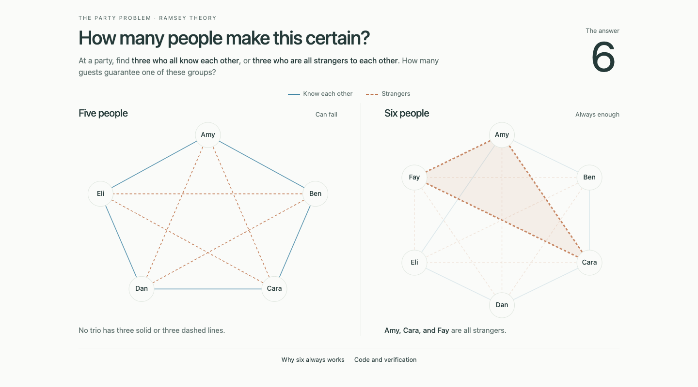

# Ramsey six-person party problem

A small, reproducible example of agent-assisted mathematical research, with a single-page visual explanation and a complete proof.

**[Open the visual explanation](https://deepujain.github.io/ramsey-six-person-party-problem/)** — no checkout, download, or installation needed.

**Problem:** What is the smallest number of people that guarantees either three mutual acquaintances or three mutual strangers? Relationships are mutual, and every pair is classified into exactly one of these categories.

**Answer: 6**, the classical Ramsey number R(3,3). This repository demonstrates an established theorem; it does not claim a new result or a solution to an open problem.

## The problem in simple words

Imagine you invite people to a party. For every pair, they either **know each other** or **have never met**.

We're looking for a group of three where either:

- **All three know each other**, or
- **None of the three know each other**.

The question is: **How many people must attend to guarantee that one of these groups exists?**

The answer is **six**. With five people, it's possible to avoid both kinds of group. With six, one must exist—whatever their relationships.

In the visualization, each dot is a person. Solid lines mean "know each other"; dashed lines mean "strangers." You're looking for a triangle made of **three solid lines or three dashed lines**.

## Visual answer



The two examples are visible together. Five can avoid both kinds of group. Six always guarantees one; Amy, Cara, and Fay are the example highlighted here.

## Explore

**[Open the visual explanation](https://deepujain.github.io/ramsey-six-person-party-problem/)**. The question, answer, and comparison are visible together. There are no steps, Next/Back buttons, relationship selectors, or required clicks. An optional link leads to the full proof.

For offline use, download [index.html](https://github.com/deepujain/ramsey-six-person-party-problem/raw/refs/heads/main/index.html) and open it in a modern browser. This standalone file is both the source and the runnable page. It needs no libraries, installation, or build step.

## Reproduce the computation

Python 3.9 or later, with no third-party dependencies:

```sh
python3 verify.py
```

The verifier enumerates every labeled two-coloring for 3 through 6 vertices, checks every vertex triple, asserts independently expected counts, checks the explicit pentagon counterexample, and prints machine-readable JSON. Six vertices require checking 32,768 colorings, each containing 20 triples.

| People | Colorings | Colorings avoiding both types of triangle |
| --- | ---: | ---: |
| 3 | 8 | 6 |
| 4 | 64 | 18 |
| 5 | 1,024 | 12 |
| 6 | 32,768 | 0 |

Read [PROOF.md](PROOF.md) for the mathematical proof and [RESEARCH.md](RESEARCH.md) for the parallel investigation and rejected hypothesis.

The proof is written for human review; it is not machine-checked in a proof assistant. Exhaustive enumeration checks this finite instance independently. A browser is an exploration tool, not the basis of the proof.

## Optional browser checks

With Playwright and its Chromium browser installed in your development environment, run:

```sh
node test_ui.cjs
```

Set `CHROME_CHANNEL=chrome` to use an installed Google Chrome instead. The checks verify both diagrams and their relationship counts, confirm that no controls are required, and check for scrolling and JavaScript errors across phone, tablet, and desktop sizes. The visualization itself needs no dependencies.
